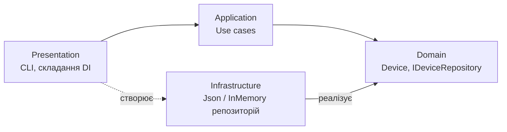

# Облік обладнання комп’ютерної лабораторії

Консольний застосунок на Python, побудований за принципами Clean Architecture.
Дозволяє вести облік обладнання лабораторії: додавати пристрої, переглядати
список, видавати пристрої та приймати їх назад.

## Архітектура



| Шар | Каталог | Відповідальність |
|---|---|---|
| Domain | `src/domain` | сутність Device, правила видачі й повернення, інтерфейс IDeviceRepository, винятки |
| Application | `src/application` | use cases: додати, показати, видати, повернути пристрій |
| Infrastructure | `src/infrastructure` | реалізації сховища: InMemory та JSON-файл |
| Presentation | `src/presentation` | консольне меню, складання залежностей (DI) |

Усі залежності спрямовані до шару Domain: Application та Infrastructure
залежать від Domain, а сам Domain не залежить ні від кого.

## Структура проєкту

```text
appsettings.json
src/
  domain/          entities/device.py, interfaces/device_repository.py, exceptions.py
  application/     use_cases/ (add, list, issue, return)
  infrastructure/  repositories/ (in_memory, json)
  presentation/    cli/main.py
```

## Збірка і запуск

Вимоги: Python 3.9 або новіший

```bash
git clone https://github.com/ВАШ_ЛОГІН/device-inventory-clean-arch.git
cd device-inventory-clean-arch
python3 -m src.presentation.cli.main
```

Спосіб зберігання даних задається у файлі `appsettings.json`:
`"type": "json"` (файл `data/devices.json`) або `"type": "memory"` (у пам’яті).

## Гілкування

- `main` — стабільний код, релізи (тег `v1.0.0`);
- `develop` — інтеграційна гілка;
- `feature/*` — гілки під окремі задачі, зливаються через pull request.

<<<<<<< HEAD
Повідомлення комітів оформлено за Conventional Commits (feat, fix, docs, chore).
=======
Повідомлення комітів оформлено за Conventional Commits (feat, fix, docs, chore).

---
 
# Звіт про виконання лабораторної роботи №5
 
## 1. Мета роботи
 
Сформувати практичні навички проєктування шаруватої архітектури застосунку за принципами Clean Architecture та освоїти базовий і командний робочий процес у Git: від створення репозиторію до злиття змін через pull request. Кожен архітектурний шар розроблено в окремій гілці з осмисленими комітами та рев’ю перед злиттям.
 
## 2. Предметна область
 
**«Облік обладнання комп’ютерної лабораторії коледжу»** (Device Inventory). Лаборант веде облік техніки (комп’ютери, монітори, маршрутизатори): кожен пристрій має інвентарний номер, назву, розташування (кабінет) і статус. Пристрій можна видати студенту чи викладачу та прийняти назад.
 
| Елемент | Опис |
|---|---|
| Сутність `Device` | `inventory_number`, `name`, `location`, `status` (`available` / `issued`), `holder` |
| Бізнес-правила | номер унікальний; видати можна лише вільний пристрій; повернути можна лише виданий; під час видачі обов’язково вказується, кому |
| Use cases | `AddDeviceUseCase`, `ListDevicesUseCase` (усі або лише вільні), `IssueDeviceUseCase`, `ReturnDeviceUseCase` |
| Сховище | `JsonDeviceRepository` (файл `data/devices.json`) та `InMemoryDeviceRepository` |
| Технології | Python 3, Git, GitHub, GitHub Codespaces |
 
> Предметну область погоджено з викладачем (завдання 1). Ця сама предметна область є основою лабораторної роботи №6.
 
## 3. Хід роботи
 
### 3.1. Підготовка репозиторію
 
1. Створено публічний репозиторій `device-inventory-clean-arch` на GitHub із файлами `README.md` та `.gitignore` (шаблон Python).
2. Репозиторій склоновано в середовище GitHub Codespaces (`git clone`), налаштовано `user.name` та `user.email` (`git config --global`).
3. Створено гілку `develop` від `main` і відправлено на GitHub (`git checkout -b develop`, `git push -u origin develop`).
 
**Політика гілкування:**
 
| Гілка | Призначення |
|---|---|
| `main` | стабільний код і релізи (тег `v1.0.0`) |
| `develop` | інтеграційна гілка, куди зливаються готові feature-гілки |
| `feature/*` | гілки під окремі задачі, зливаються лише через pull request |
 
### 3.2. Структура проєкту
 
```text
device-inventory-clean-arch/
├── README.md
├── .gitignore
├── appsettings.json
└── src/
    ├── domain/
    │   ├── exceptions.py
    │   ├── entities/device.py
    │   └── interfaces/device_repository.py
    ├── application/use_cases/
    │   ├── add_device.py
    │   ├── list_devices.py
    │   ├── issue_device.py
    │   └── return_device.py
    ├── infrastructure/repositories/
    │   ├── in_memory_device_repository.py
    │   └── json_device_repository.py
    └── presentation/cli/main.py
```
 
### 3.3. Гілки, коміти та pull request-и
 
| Гілка | Що реалізовано | PR | Рев’ю-коментар → виправлення |
|---|---|---|---|
| `feature/domain-layer` | винятки, сутність `Device`, інтерфейс `IDeviceRepository` (3 коміти) | #1 | додати докстрінг до `Device` → `docs(domain): додати докстрінг до Device…` |
| `feature/application-layer` | чотири use case-и (3 коміти) | #2 | потрібен фільтр вільних пристроїв → `feat(application): додати фільтр only_available…` |
| `feature/infrastructure-layer` | `InMemoryDeviceRepository`, `JsonDeviceRepository`, конфігурація (3 коміти) | #3 | створювати каталог перед записом → `fix(infrastructure): створювати каталог…` |
| `feature/presentation-layer` | консольне меню, складання залежностей (DI) | #4 | повідомляти про невідомий пункт меню → `fix(presentation): повідомляти про невідомий пункт меню` |
| `feature/docs-readme` | README, схема архітектури | #5 | вказати мінімальну версію Python → `docs: вказати мінімальну версію Python…` |
 
Повідомлення комітів оформлено за **Conventional Commits** (`feat`, `fix`, `docs`, `chore`, `merge`). У кожному pull request залишено рев’ю-коментар, а виправлення внесено окремим комітом.
 
### 3.4. Схема архітектури та залежності
 

 
Усі залежності в коді спрямовані до шару **Domain**. Шар Application працює лише через інтерфейс `IDeviceRepository`. Перевірка принципу інверсії залежностей:
 
```bash
git grep -i infrastructure src/application
```
 
Команда нічого не виводить, отже, Application не залежить від Infrastructure.
 
### 3.5. Dependency Injection
 
Точка входу `src/presentation/cli/main.py` читає `appsettings.json`, створює конкретний репозиторій і передає його в use case-и через конструктор. Бізнес-логіки в шарі Presentation немає. Спосіб зберігання змінюється значенням `"type"` у `appsettings.json` (`json` або `memory`) без зміни use case-ів.
 
### 3.6. Конфлікт злиття
 
Змодельовано конфлікт у файлі `appsettings.json`: у `feature/infrastructure-layer` шлях до сховища змінено на `data/devices.json`, а в `develop` той самий рядок — на `storage/devices.json`. Під час `git merge feature/infrastructure-layer` Git повідомив про конфлікт; його розв’язано вручну, після чого створено мердж-коміт `merge: розв’язано конфлікт конфігурації сховища даних` (`28ea90f`). Оскільки гілку злито локально, pull request #3 закрито з коментарем про ручне злиття.
 
### 3.7. Реліз
 
Після злиття всіх гілок у `develop` код перенесено в `main` (`git merge develop`) і створено тег `v1.0.0` (`git tag -a v1.0.0`, `git push origin v1.0.0`).
 
## 4. Результат роботи застосунку
 
Запуск із кореня репозиторію:
 
```bash
python3 -m src.presentation.cli.main
```
 
Приклад сеансу:
 
```text
=== Облік обладнання комп’ютерної лабораторії ===
1. Додати пристрій
2. Показати всі пристрої
3. Показати лише вільні пристрої
4. Видати пристрій
5. Повернути пристрій
0. Вийти
Ваш вибір: 1
Інвентарний номер: PC-001
Назва: Комп’ютер Dell
Розташування (кабінет): Каб. 214
Додано:
  [PC-001] Комп’ютер Dell | Каб. 214 | вільний
```
 
Реалізовані сценарії: додавання пристрою, перегляд усіх і лише вільних пристроїв, видача, повернення, обробка помилок (дублікат номера, невідомий номер, повторна видача, повернення невиданого пристрою, невідомий пункт меню).
 
## 5. Висновки
 
У ході роботи спроєктовано застосунок «Облік обладнання комп’ютерної лабораторії» за принципами Clean Architecture із шарами Domain, Application, Infrastructure та Presentation. Напрямок залежностей витримано: Domain не залежить від інших шарів, use case-и працюють через інтерфейс `IDeviceRepository`, а конкретне сховище вибирається в точці входу через Dependency Injection. Це дозволило змінювати спосіб зберігання даних без змін бізнес-логіки.
 
Освоєно командний процес роботи з Git: гілки `main`, `develop`, `feature/*`, коміти за Conventional Commits, pull request-и з рев’ю та виправленнями, розв’язання конфлікту злиття та створення тегу релізу `v1.0.0`.
 
---
 
# Відповіді на контрольні запитання
 
### 1. У чому полягає принцип інверсії залежностей і як він реалізований у структурі проєкту?
 
Принцип інверсії залежностей (DIP) стверджує, що модулі верхнього рівня не повинні залежати від модулів нижнього рівня: обидва мають залежати від абстракцій. Абстракції не залежать від деталей, а деталі залежать від абстракцій. У проєкті use case-и (шар Application) приймають у конструкторі інтерфейс `IDeviceRepository`, оголошений у Domain, і ніколи не імпортують `JsonDeviceRepository`. Конкретна реалізація лежить в Infrastructure і наслідує цей інтерфейс, тому залежність спрямована від деталі до абстракції. Конкретний об’єкт створюється лише в `main.py`. Команда `git grep -i infrastructure src/application` не знаходить жодного збігу.
 
```python
class AddDeviceUseCase:
    def __init__(self, repository: IDeviceRepository) -> None:
        self._repository = repository
```
 
### 2. Чому Domain-шар не повинен мати залежностей від Infrastructure чи Presentation?
 
Domain містить найважливіші й найстабільніші речі — бізнес-правила, наприклад «видати можна лише вільний пристрій». Технології зберігання та інтерфейс змінюються значно частіше, і якщо правила залежатимуть від них, кожна така зміна ламатиме ядро системи. Domain без залежностей легко тестувати без файлів, бази даних чи консолі. Залежність Domain від Infrastructure створила б ще й циклічні імпорти, бо Infrastructure вже імпортує Domain заради інтерфейсу. У проєкті Domain використовує лише стандартні модулі Python: `dataclasses`, `enum`, `abc`, `typing`.
 
### 3. Яка різниця між git merge та git rebase, і коли доцільно використовувати кожен із них?
 
`git merge` поєднує дві гілки, створюючи мердж-коміт: історія зберігається такою, якою була, але стає нелінійною. `git rebase` переносить коміти поточної гілки поверх іншої, створюючи нові коміти з новими хешами, тому історія виходить лінійною. Merge доцільно використовувати для інтеграції готових гілок у спільні (`feature` → `develop`, `develop` → `main`), бо він безпечний і нічого не переписує. Rebase зручний, щоб оновити власну, ще не опубліковану feature-гілку на актуальний `develop` перед створенням PR. Rebase гілок, якими вже користуються інші, робити не слід: переписана історія спричинить проблеми в колег. У цій роботі застосовувався merge.
 
### 4. Опишіть послідовність дій при виникненні конфлікту злиття в Git.
 
Після `git merge` Git повідомляє `CONFLICT` і зупиняє злиття. Спочатку `git status` показує файли в стані «both modified». Потім відкриваємо кожен такий файл, знаходимо маркери `<<<<<<<`, `=======`, `>>>>>>>` і вирішуємо, яку версію залишити: свою, чужу чи об’єднану. Службові маркери видаляємо й перевіряємо, що файл коректний (у нашому випадку це валідний JSON). Далі виконуємо `git add файл`, щоб позначити конфлікт розв’язаним, і `git commit`, що завершує злиття. Наприкінці робимо `git push`. Якщо потрібно скасувати процес, використовується `git merge --abort`.
 
### 5. Яку роль виконує гілка develop у порівнянні з main у обраній моделі гілкування (Git Flow)?
 
Гілка `main` містить лише стабільний код, який можна випускати: кожен реліз позначається тегом (у проєкті `v1.0.0`). Гілка `develop` є інтеграційною: у неї зливаються готові feature-гілки, і саме там перевіряється, що частини застосунку працюють разом. Така схема дозволяє розробляти нові можливості, не ламаючи стабільну версію. У `main` код потрапляє лише після перевірки в `develop`. Окремі задачі виконуються в гілках `feature/*`, що ізолює незавершену роботу.
 
### 6. Навіщо потрібен pull request, якщо можна одразу зробити git merge локально?
 
Локальний `git merge` бачить лише розробник: ніхто не може переглянути зміни й залишити зауваження до того, як вони потраплять у спільну гілку. Pull request дає окреме місце для обговорення: видно різницю (diff), коментарі до конкретних рядків та історію виправлень. На PR можна налаштувати обов’язкове схвалення, автоматичні перевірки (CI) і захист гілок. Крім того, PR фіксує, хто, коли і навіщо вніс зміни. У цій роботі в кожному PR залишено коментар (наприклад, пропозицію додати докстрінг до `Device` у PR #1), а виправлення внесено окремим комітом.
 
### 7. Як конвенція Conventional Commits допомагає в супроводі проєкту?
 
Повідомлення має формат `тип(область): опис`, де тип — це `feat`, `fix`, `docs`, `refactor`, `chore` тощо. Завдяки цьому історію можна читати як змістовний журнал змін: з `git log --oneline` одразу видно, де додано функціонал, а де виправлено помилку. Формат дозволяє автоматично генерувати changelog і визначати номер наступної версії (`feat` — нова мінорна версія, `fix` — патч). Він також узгоджує стиль повідомлень у команді та полегшує пошук потрібних комітів. Приклад із проєкту: `feat(domain): додати сутність Device зі статусом та бізнес-правилами`.
 
### 8. Опишіть структуру каталогів вашого проєкту за шарами Clean Architecture. Поясніть, у якому шарі розміщено інтерфейс репозиторію, а в якому — його реалізацію, і чому саме так.
 
```text
src/
├── domain/
│   ├── exceptions.py
│   ├── entities/device.py
│   └── interfaces/device_repository.py     <- IDeviceRepository
├── application/use_cases/                  <- Add / List / Issue / Return
├── infrastructure/repositories/            <- InMemory..., Json...Repository
└── presentation/cli/main.py                <- меню та DI
```
 
Інтерфейс `IDeviceRepository` розміщено в Domain, а його реалізації `InMemoryDeviceRepository` і `JsonDeviceRepository` — в Infrastructure. Domain визначає, **що** потрібно бізнес-логіці від сховища (контракт), а Infrastructure — **як** це зробити технічно. Тому Application залежить лише від Domain, а зміна способу зберігання не зачіпає use case-ів.
 
### 9. Наведіть фрагмент коду точки входу вашого застосунку (Presentation-шар), де залежності збираються через Dependency Injection, і поясніть, як замінити спосіб зберігання даних без зміни use cases.
 
```python
def build_repository(settings: dict) -> IDeviceRepository:
    storage = settings["storage"]
    if storage["type"] == "memory":
        return InMemoryDeviceRepository()
    if storage["type"] == "json":
        return JsonDeviceRepository(ROOT_DIR / storage["path"])
    raise ValueError(f"Невідомий тип сховища: {storage['type']}")
 
 
def main() -> None:
    repository = build_repository(load_settings())
    add_device = AddDeviceUseCase(repository)
    list_devices = ListDevicesUseCase(repository)
    issue_device = IssueDeviceUseCase(repository)
    return_device = ReturnDeviceUseCase(repository)
```
 
Конкретне сховище створюється в одному місці й передається в use case-и через конструктор. Щоб замінити спосіб зберігання, достатньо змінити `"type"` в `appsettings.json` (`json` ↔ `memory`), що перевірено під час роботи. Для нового сховища (наприклад, SQLite) потрібно написати клас `SqliteDeviceRepository(IDeviceRepository)` в Infrastructure та додати одну гілку в `build_repository`. Код use case-ів при цьому не змінюється взагалі.
 
### 10. Опишіть конфлікт злиття, який ви змоделювали в роботі: у якому файлі та між якими гілками він виник, як виглядали маркери конфлікту і яке рішення ви прийняли під час його розв’язання.
 
Конфлікт виник у файлі `appsettings.json` під час `git merge feature/infrastructure-layer`, виконаного на гілці `develop`. У `feature/infrastructure-layer` рядок зі шляхом до сховища змінено на `data/devices.json`, а в `develop` той самий рядок — на `storage/devices.json`, тому Git не зміг об’єднати зміни автоматично.
 
```text
<<<<<<< HEAD
    "path": "storage/devices.json"
=======
    "path": "data/devices.json"
>>>>>>> feature/infrastructure-layer
```
 
Я залишив варіант `data/devices.json`, бо саме для цього каталогу додано правило в `.gitignore`, і його використовує `JsonDeviceRepository`. Маркери видалено, файл перевірено на коректність JSON, після чого виконано `git add appsettings.json` і `git commit -m "merge: розв’язано конфлікт конфігурації сховища даних"`.
>>>>>>> develop
