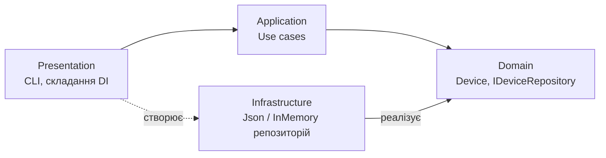

# Облік обладнання комп’ютерної лабораторії

Консольний застосунок на Python, побудований за принципами Clean Architecture.
Дозволяє вести облік обладнання лабораторії: додавати пристрої, переглядати
список, видавати пристрої та приймати їх назад.

## Архітектура



| Шар | Каталог | Відповідальність |
|---|---|---|
| Domain | `src/domain` | сутність Device, правила видачі й повернення, інтерфейс IDeviceRepository, винятки |
| Application | `src/application` | use cases: додати, показати, видати, повернути пристрій |
| Infrastructure | `src/infrastructure` | реалізації сховища: InMemory та JSON-файл |
| Presentation | `src/presentation` | консольне меню, складання залежностей (DI) |

Усі залежності спрямовані до шару Domain: Application та Infrastructure
залежать від Domain, а сам Domain не залежить ні від кого.

## Структура проєкту

```text
appsettings.json
src/
  domain/          entities/device.py, interfaces/device_repository.py, exceptions.py
  application/     use_cases/ (add, list, issue, return)
  infrastructure/  repositories/ (in_memory, json)
  presentation/    cli/main.py
```

## Збірка і запуск

Вимоги: Python 3.9 або новіший

```bash
git clone https://github.com/ВАШ_ЛОГІН/device-inventory-clean-arch.git
cd device-inventory-clean-arch
python3 -m src.presentation.cli.main
```

Спосіб зберігання даних задається у файлі `appsettings.json`:
`"type": "json"` (файл `data/devices.json`) або `"type": "memory"` (у пам’яті).

## Гілкування

- `main` — стабільний код, релізи (тег `v1.0.0`);
- `develop` — інтеграційна гілка;
- `feature/*` — гілки під окремі задачі, зливаються через pull request.

Повідомлення комітів оформлено за Conventional Commits (feat, fix, docs, chore).